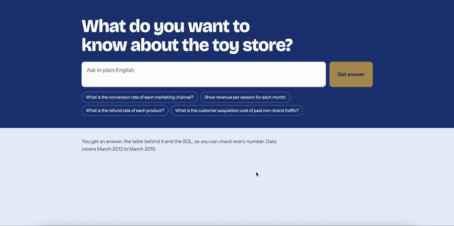

# Toy Store SQL Assistant

Ask a business question in plain English. The app writes the SQL, runs it on a read-only connection, and shows the table, the SQL and a short summary.

The interesting part is not the chat box. It is the evaluation: 30 questions with known answers measure how often the AI is right, and whether adding business rules improves it.

Built on the data from my [Toy Store product analytics project](https://github.com/gamzerol/toy-store-product-analytics), whose metric definitions became the assistant's business rules.

**Tools:** React, TypeScript, Node.js, PostgreSQL, Gemini API



## How it works

1. The model receives the question, the schema and the business rules, and returns a query or says the data can't answer the question.
2. The query goes through the safety check.
3. It runs on the database. If the check or the query fails, the model gets the error and one chance to fix it.
4. The model summarises the rows in up to two sentences. The UI always shows the table and SQL next to it.

## Safety

The model's output is treated as untrusted, so there are three separate layers:

| Layer         | What it does                                                                                                        | Where                                          |
| ------------- | ------------------------------------------------------------------------------------------------------------------- | ---------------------------------------------- |
| SQL check     | Parses the query with the Postgres parser. Allows one SELECT, the six project tables and a list of known functions. | [`server/sqlGuard.ts`](server/sqlGuard.ts)     |
| Transaction   | Runs read-only with a 10 second timeout and returns up to 1,000 rows.                                               | [`server/db.ts`](server/db.ts)                 |
| Database role | The app's role only has SELECT on these tables.                                                                     | [`db/readonly_role.sql`](db/readonly_role.sql) |

## Evaluation

[`evals/questions.ts`](evals/questions.ts) holds 30 questions, each with a correct SQL query and the mistake it is designed to catch:

- **27 answerable questions:** basics, metrics, channels, funnel, experiments, cross-sell, refunds and repeat visits.
- **3 unanswerable questions:** the correct behaviour is to say the data can't answer them, for example acquisition cost when there is no spend data.

The runner executes both the model's query and the correct query, then compares the results rather than the SQL text. Column names, column order, row order and extra columns don't matter. Numbers can differ by up to 1%, and 0.07 matches 7%.

Limits to keep in mind:

- I wrote the questions, and several depend on rules that are in v2 only, such as the channel definition. The comparison shows the value of those rules, not general model quality.
- An answer in a different but valid shape is scored as wrong, for example one row with two columns instead of two rows. I review failures by hand and report any such case.
- The summary sentences are not scored.
- 30 questions is a small set, so a difference of one or two questions means little.

## Run it

You need Node.js 22 and the Toy Store data loaded into a `toystore` schema in PostgreSQL. Table definitions are in [`context/schema.sql`](context/schema.sql).

```bash
npm install
cp .env.example .env
```

1. Change the password in `db/readonly_role.sql`, then run the file as an admin user.
2. Put that password in `DATABASE_URL` and your [Gemini API key](https://aistudio.google.com/apikey) in `GEMINI_API_KEY`.
3. Start the app and open http://localhost:5173.

```bash
npm run dev
```

## Run the evaluation

```bash
npm run eval:check          # checks the correct queries against your data
npm run eval -- --prompt v1
npm run eval -- --prompt v2
```

Results are saved to `evals/results/`. Compare the correct queries with the numbers in the analytics project first, because the score is only as good as they are.

## Tests

```bash
npm test
```

Safety check and comparison tests run without a database. To include the Postgres tests, load `context/schema.sql` and `tests/fixtures/sample_data.sql` into a test database (the fixture is made-up data) and set `TEST_DATABASE_URL`.
